

# أتلانتيك السودان — عرض الموقع

[English](README.md) | **العربية**

موقع إلكتروني ثنائي اللغة (العربية / الإنجليزية) لشركة **أتلانتيك السودان**، وهي شركة سودانية تتولى
توريد المنتجات الزراعية والموارد القابلة للتصدير من منتجين في مختلف أنحاء السودان، وتوفّرها للمستوردين
وشركات التجارة حول العالم.

**الموقع المباشر: [www.atlantic-sudan.com](https://www.atlantic-sudan.com)**

> تعرض هذه الصفحة ما يقدّمه الموقع وكيفية استخدامه. الكود المصدري محفوظ في مستودع خاص.

  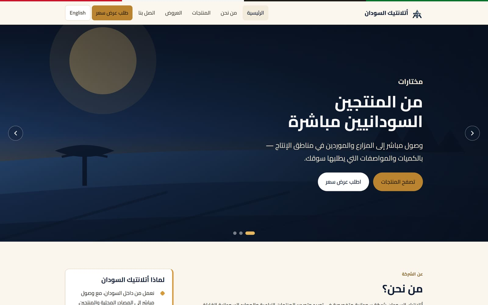

---

## أبرز المزايا

- **لغتان في موقع واحد** — كل صفحة بالعربية (من اليمين إلى اليسار) والإنجليزية (من اليسار إلى اليمين)، مع تبديل بضغطة واحدة.
- **تصميم يطابق الهوية** — مظهر بالكحلي والذهبي مبني حول شعار أتلانتيك الرسمي، ويعمل على الهواتف والأجهزة اللوحية وأجهزة الحاسوب.
- **كتالوج المنتجات** — فئات ومواصفات وطلب عرض سعر بضغطة واحدة لكل منتج.
- **العروض** — قائمة متجددة بالكميات المتاحة حديثاً وفرص التوريد.
- **طلب عرض سعر (RFQ)** — يصف المشتري احتياجه ويرسله مباشرة إلى الشركة عبر واتساب أو البريد الإلكتروني.
- **لوحة إدارة المحتوى للموظفين** — إضافة المنتجات والإعلانات وتعديلها، مع الصور والعناوين والأوصاف باللغتين، دون الحاجة إلى مطوّر *(تتطلب استضافة تدعم PHP — راجع [الحالة](#الحالة))*.

---

## المزايا بالتفصيل

### الصفحة الرئيسية
شريط عرض متحرك (التوريد ← ميناء بورتسودان ← الشحن إلى العالم)، ونبذة مختصرة عن الشركة، والخدمات، و«لماذا أتلانتيك السودان»، والمنتجات المميزة، وأحدث العروض، ودعوة لاتخاذ إجراء.

  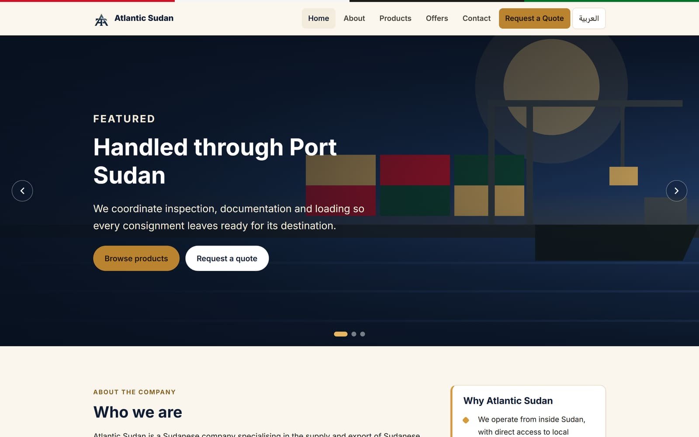
  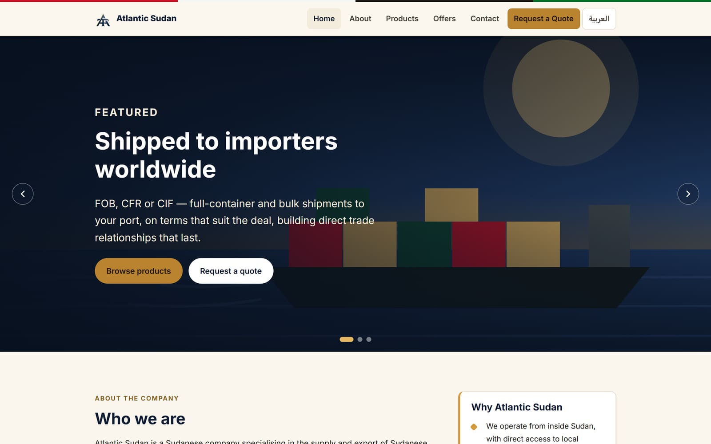

### المنتجات
جميع المنتجات القابلة للتصدير مع تصفية حسب الفئة (البذور الزيتية، الصموغ والراتنجات، الحبوب والبقوليات، الأعشاب والنباتات، الثروة الحيوانية والجلود). لكل منتج صفحته الخاصة بوصف وجدول مواصفات — المنشأ، موسم الحصاد، الدرجات، التعبئة، الحد الأدنى للطلب، شروط التوريد والرمز الجمركي.

  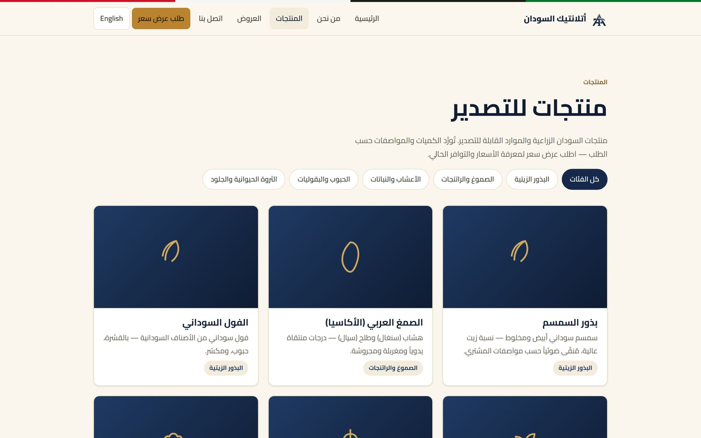
  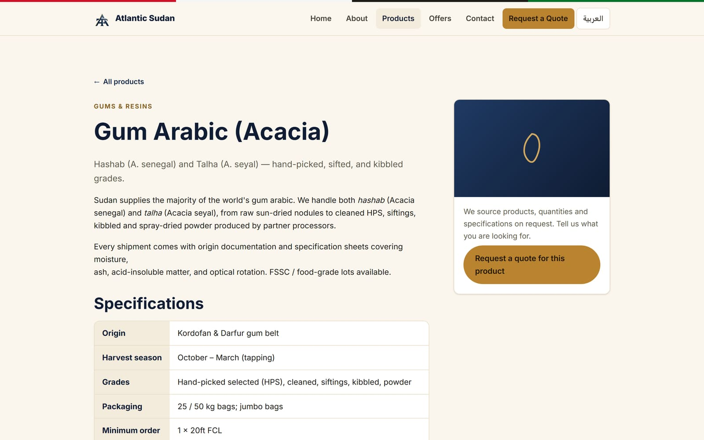

### العروض
منتجات متاحة حديثاً وفرص توريد، الأحدث أولاً، مع إبقاء العروض المثبّتة في الأعلى. لكل عرض صفحته، ويمكن ربطه بالمنتج المعني.

  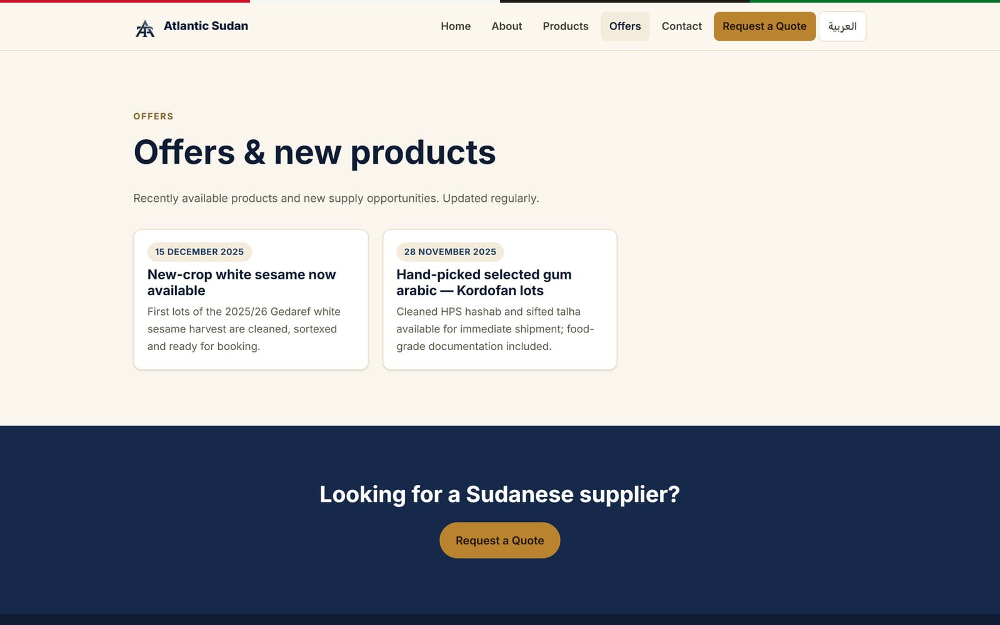

### طلب عرض سعر (RFQ)
نموذج منظّم: المنتج، الكمية، المواصفات المطلوبة، بلد وميناء الوصول، شروط التوريد (Incoterms)، وبيانات الشركة والتواصل. يتم التحقق من الحقول المطلوبة قبل الإرسال.

  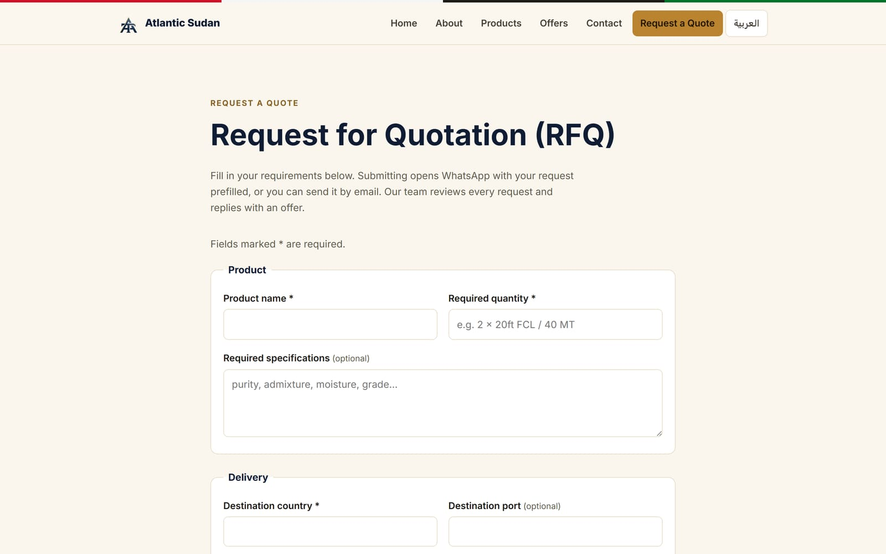

### عربي بالكامل من اليمين إلى اليسار
في أعلى كل صفحة زر لتبديل اللغة يُبقي الزائر على الصفحة نفسها بلغة أخرى. وصفحات اللغة العربية معكوسة بالكامل من اليمين إلى اليسار، بما في ذلك القوائم والبطاقات والنماذج.

  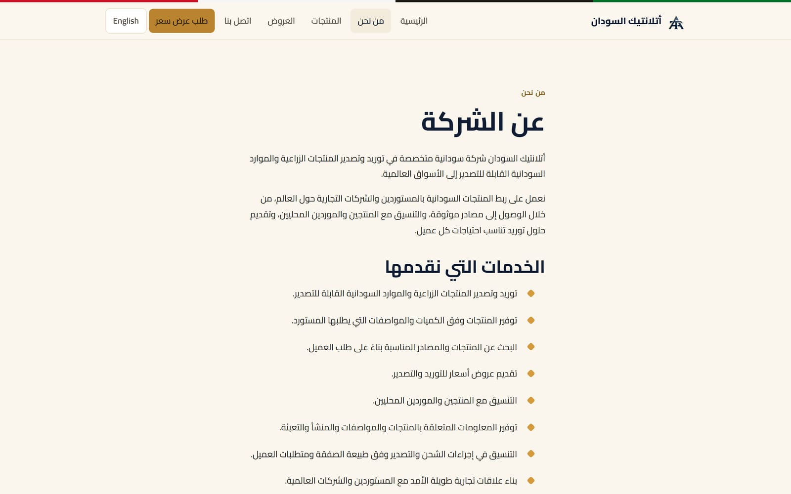

### على الهاتف

  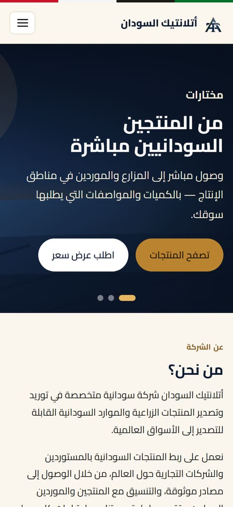
  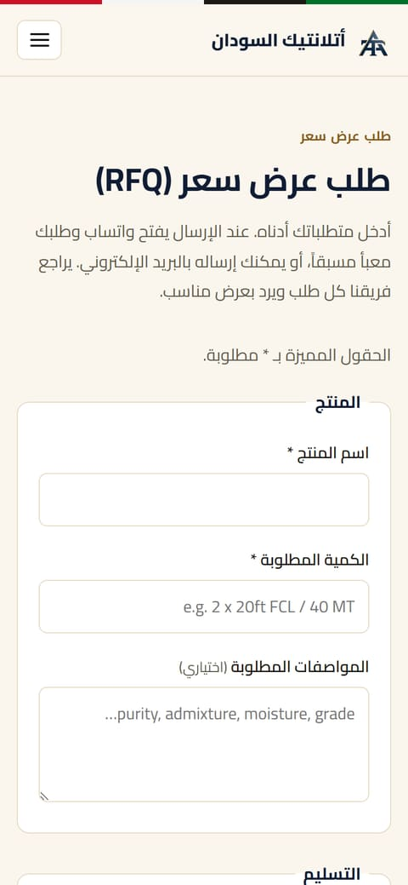
  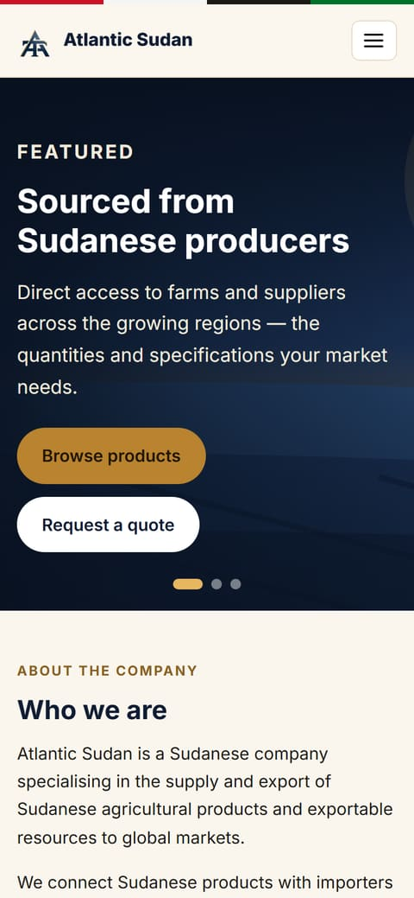
  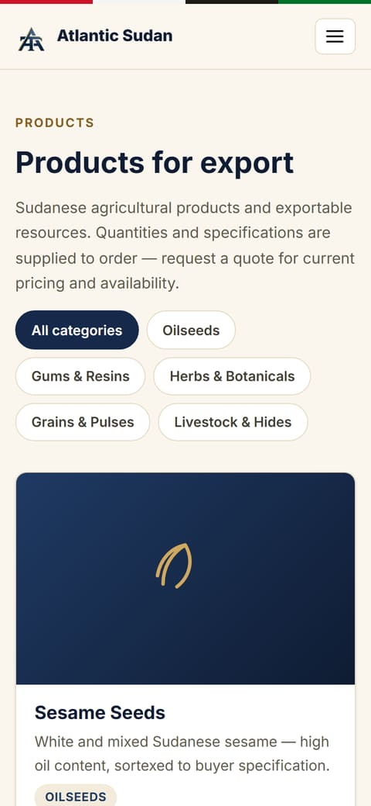

---

## طريقة الاستخدام

### للمشترين — طلب عرض سعر
1. افتح **طلب عرض سعر**، أو اضغط **«اطلب عرض سعر لهذا المنتج»** في صفحة المنتج (فيُملأ اسم المنتج تلقائياً).
2. املأ النموذج. الحقول المميزة بعلامة `*` مطلوبة.
3. اختر طريقة الإرسال:
   - **إرسال عبر واتساب** — يفتح واتساب والطلب مكتوب بالكامل مسبقاً، موجّهاً إلى الشركة.
   - **إرسال بالبريد الإلكتروني** — يفتح تطبيق البريد والطلب جاهز للإرسال إلى الشركة.

لا يُحفظ أي شيء على خادم: يصل الطلب مباشرة من المشتري إلى الشركة.

### للموظفين — إدارة المنتجات والإعلانات
لوحة إدارة المحتوى منطقة محمية بكلمة مرور في الموقع.

1. **سجّل الدخول.** بعد خمس محاولات خاطئة يُقفل الدخول لمدة خمس دقائق.
2. **لوحة التحكم** تعرض كل المنتجات والإعلانات مع حالة كل منها:
   - **Live (منشور)** — النسخة المنشورة تطابق آخر تعديل.
   - **Unpublished changes (تعديلات غير منشورة)** — عُدِّل العنصر لكن الموقع المباشر ما زال يعرض النسخة الأقدم.
   - **Not published (غير منشور)** — لم يُنشر من قبل.
3. **إضافة منتج أو تعديله:** عنوان الصفحة (المفتاح)، والفئة، وترتيب العرض، وخيار *Featured* لإظهاره في الصفحة الرئيسية، وصورة (JPEG أو PNG أو WEBP حتى 5 ميجابايت)، وباللغتين **العربية والإنجليزية** — العنوان والملخص القصير والوصف الكامل وحقول المواصفات.
4. **إضافة إعلان أو تعديله:** التاريخ، ومنتج مرتبط (اختياري)، وخيار *Pinned* للتثبيت، والعنوان والملخص والنص باللغتين.
5. **Save draft (حفظ المسودة).** الحفظ يغيّر المسودة فقط — الموقع العام لا يتغير بعد.
6. **Publish (نشر)** عند الجاهزية. يتطلب النشر ملء العنوان والملخص بكلتا اللغتين، حتى لا تُنشر صفحة مترجمة جزئياً.
7. **Delete (حذف)** يزيل العنصر من المسودة والموقع المباشر بعد التأكيد.

تعديلات العنصر المنشور فعلاً تظهر على الموقع فوراً. والعنصر الجديد كلياً يظهر في القوائم مباشرة، أما عنوان صفحته الخاصة فيُنشأ عند التحديث التالي للموقع.

---

## الحالة

- **يعمل الآن:** الموقع العام باللغتين على [www.atlantic-sudan.com](https://www.atlantic-sudan.com).
- **لوحة إدارة المحتوى:** مبنية ومراجعة، لكنها تحتاج استضافة ويب تدعم PHP. الاستضافة الحالية ثابتة، لذلك يجري فريق التطوير تعديلات المنتجات والعروض في الوقت الحالي. الانتقال إلى استضافة PHP يفعّل لوحة الإدارة.
- **مخطط لمرحلة لاحقة:** مساعد ذكي يساعد المشترين في العثور على المنتجات وتحويل المحادثة إلى طلب عرض سعر.

---

## التقنيات المستخدمة

[Astro](https://astro.build) (موقع ثابت سريع)، وTypeScript، وCSS عادي، مع لوحة إدارة صغيرة بلغة PHP. مستضاف على Azure Static Web Apps. دون قاعدة بيانات.

*الكود المصدري: مستودع خاص.*

