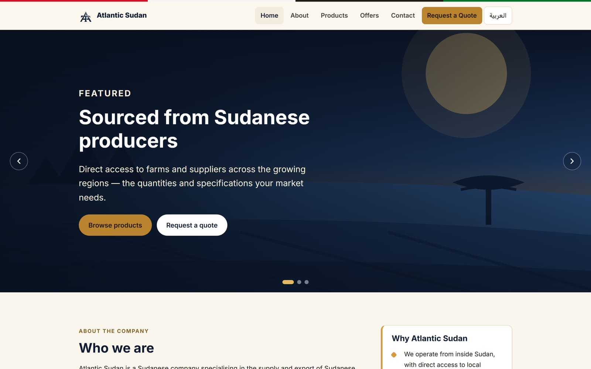
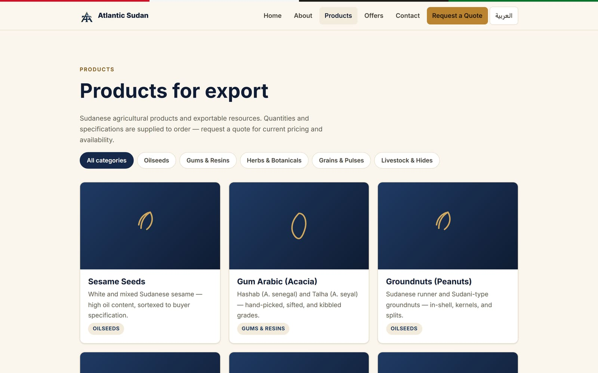

# Atlantic Sudan — Website Showcase

**English** | [العربية](README.ar.md)

A bilingual (English / Arabic) website for **Atlantic Sudan**, a Sudan-based company that sources
agricultural products and exportable resources from producers across Sudan and supplies them to
importers and trading companies worldwide.

**Live website: [www.atlantic-sudan.com](https://www.atlantic-sudan.com)**

> This page presents what the website does and how it is used. The source code is kept in a private repository.

  

---

## Highlights

- **Two languages, one site** — every page in English (left-to-right) and Arabic (right-to-left), switchable in one click.
- **Brand-matched design** — a navy-and-gold look built around the official Atlantic logo, working on phones, tablets and desktops.
- **Product catalogue** — categories, specifications and a one-click quote request for every product.
- **Offers** — a running list of newly available lots and supply opportunities.
- **Request a Quote (RFQ)** — buyers describe what they need and send it straight to the company by WhatsApp or email.
- **Staff content manager** — products and announcements, with pictures, titles and descriptions in both languages, can be added and edited without a developer *(needs PHP hosting — see [Status](#status))*.

---

## Features

### Home
A rotating hero (sourcing → Port Sudan → worldwide shipping), a short company introduction, services, "why Atlantic Sudan", featured products, the latest offers and a call to action.

  
  

### Products
Every exportable product, filterable by category (oilseeds, gums & resins, grains & pulses, herbs & botanicals, livestock & hides). Each product has its own page with a description and a specifications table — origin, harvest season, grades, packaging, minimum order, supply terms and HS code.

  
  

### Offers
Recently available products and supply opportunities, newest first, with pinned offers kept on top. Each offer has its own page and can link to the related product.

  

### Request a Quote (RFQ)
A structured form: product, quantity, required specifications, destination country and port, supply terms (Incoterms), and company and contact details. Required fields are checked before sending.

  

### Arabic, fully right-to-left
Every page has a language button in the header that keeps the visitor on the same page in the other language. Arabic pages are mirrored right-to-left, including navigation, cards and forms.

  
  

### On mobile

  
  
  
  

---

## How it is used

### For buyers — requesting a quote
1. Open **Request a Quote**, or press **"Request a quote for this product"** on a product page (this fills in the product name).
2. Fill in the form. Fields marked `*` are required.
3. Choose how to send it:
   - **Send via WhatsApp** — WhatsApp opens with the whole request already written, addressed to the company.
   - **Send by email** — the email app opens with the request ready to send to the company.

Nothing is stored on a server: the request goes directly from the buyer to the company.

### For staff — managing products and announcements
The content manager is a password-protected area of the site.

1. **Log in.** After five wrong attempts, login locks for five minutes.
2. The **dashboard** lists all products and announcements with a status:
   - **Live** — the published version matches your latest edit.
   - **Unpublished changes** — edited, but the live site still shows the older version.
   - **Not published** — never gone live.
3. **Add or edit a product:** page address (key), category, sort order, a *Featured* option for the home page, a picture (JPEG, PNG or WEBP, up to 5 MB), and — in **English and Arabic** — title, short summary, full description and specification fields.
4. **Add or edit an announcement:** date, optional related product, a *Pinned* option, and title, summary and text in both languages.
5. **Save draft.** Saving only changes the draft — the public site does not change yet.
6. **Publish** when ready. Publishing requires the title and summary in **both** languages, so a page never goes live half-translated.
7. **Delete** removes an item from the draft and the live site, after a confirmation.

Edits to an item that is already live appear on the website immediately. A brand-new item appears in the lists right away; its own page address is created at the next site update.

---

## Status

- **Live now:** the public website, in both languages, at [www.atlantic-sudan.com](https://www.atlantic-sudan.com).
- **Content manager:** built and reviewed, but it needs web hosting that supports PHP. The current hosting is static, so product and offer changes are made by the development team for now. Moving to PHP hosting turns the content manager on.
- **Planned for a later phase:** an AI assistant to help buyers find products and turn a conversation into a quote request.

---

## Built with

[Astro](https://astro.build) (fast static site), TypeScript and plain CSS, with a small PHP content manager. Hosted on Azure Static Web Apps. No database.

*Source code: private repository.*
